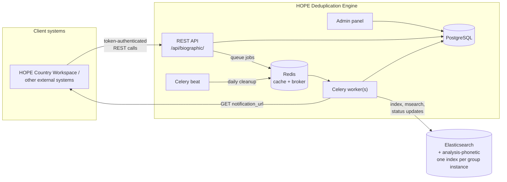

# Architecture

Biographic deduplication reuses the engine's web, worker and beat processes, and adds one backing service: a dedicated Elasticsearch cluster.

## Components

- **REST API** — create a set, upload records, process, cancel, approve, reject, read findings. All routes are scoped by business area and program in the URL. Interactive documentation is at `/api/rest/swagger/`.
- **PostgreSQL** — the source of truth. It owns the lifecycle, the records, the findings and every decision. Nothing about whether a set is approved is decided in Elasticsearch.
- **Elasticsearch** — indexes and scores records. Each indexed record is a document tagged with a status (`pending`, `approved`, `rejected`) that mirrors the set's state in Postgres.
- **Celery worker** — runs `process_biographic_dataset` (index, score, store findings), `update_biographic_status` (mirror a decision into Elasticsearch) and `cleanup_biographic_rejected`.
- **Celery beat** — runs the daily deletion of rejected documents.
- **Admin panel** — program settings, set and job inspection, recovery buttons. See [Operations](../admin/operations.md).

## Key design points

- **Postgres decides, Elasticsearch follows.** Approve and reject commit the new state and a `search_sync_pending` flag in one transaction; cancel does so only for a failed set that may have indexed documents. A status update is then queued. If it is lost, the next run in the group reconciles every flagged set *before* searching, so rejected documents cannot be matched as population.
- **One index per group instance.** A business area plus a program code identifies the active `BiographicGroup` in Postgres. Each group has its own Elasticsearch index, `{ELASTICSEARCH_PREFIX}biographic_{group_id}`, where `group_id` is the group's internal database PK. Clients continue to use the business area and program code in the REST API; they never send or store the group PK. Different programs and successive registrations of the same program cannot search each other's people, and processing locks are independent.
- **Group-level soft deletion.** Deleting a program marks its active group `deleted=True`, hides its sets from the API and allows a new group to be registered under the same business area and program code. The replacement receives a new PK and starts with an empty population in a separate index, created on its first processing run. The old group's PostgreSQL data and Elasticsearch index remain physically present; their physical cleanup is planned separately and is not part of SoftDelete.
- **One search covers both scopes.** Each person is searched once, against the rest of their own set (still `pending`) and the approved population. Each hit says which set it came from, so batch and population duplicates are told apart afterwards.
- **One active set per program.** A database constraint allows a single set in the processing or awaiting-decision states per program, and a processing lock stops two runs overlapping. Pending and failed sets do not count. See [Lifecycle](lifecycle.md).
- **Scores are HOPE's.** Index settings, analyzers, the similarity script and the query are ported from HOPE line by line, and parity tests pin known HOPE scores. See [Scoring pipeline](pipeline.md).
- **Separate authentication.** Biographic endpoints use `hope_api_auth` tokens with the `API_BIOGRAPHIC` grant, not the biometric system-scoped tokens. See [authentication](../integration/index.md#authentication).
