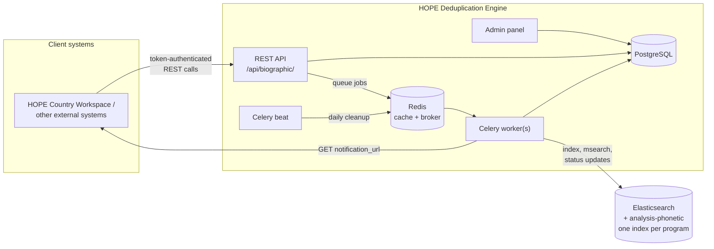

# Architecture

Biographic deduplication reuses the engine's web, worker and beat processes, and adds one backing service: a dedicated Elasticsearch cluster.

## Components

- **REST API** — create a set, upload records, process, cancel, approve, reject, read pairs. All routes are scoped by business area and program in the URL. Interactive documentation is at `/api/rest/swagger/`.
- **PostgreSQL** — the source of truth. It owns the lifecycle, the records, the findings and every decision. Nothing about whether a set is approved is decided in Elasticsearch.
- **Elasticsearch** — only scores. It holds one document per person, tagged with a status (`pending`, `approved`, `rejected`) that mirrors the set's state in Postgres.
- **Celery worker** — runs `process_biographic_dataset` (index, score, store findings), `update_biographic_status` (mirror a decision into Elasticsearch) and `cleanup_biographic_rejected`.
- **Celery beat** — runs the daily deletion of rejected documents.
- **Admin panel** — program settings, set and job inspection, recovery buttons. See [Operations](../admin/operations.md).

## Key design points

- **Postgres decides, Elasticsearch follows.** Approve, reject and cancel commit the new state and a `search_sync_pending` flag in one transaction, then queue a status update. If that update is lost, the next run in the program reconciles every flagged set *before* it searches anything, so a rejected set can never be matched against.
- **One index per program.** A business area plus a program code is a *group* and maps to the index `{ELASTICSEARCH_PREFIX}biographic_{business_area}_{program_code}`. Two programs never see each other's people, and lock independently.
- **One search covers both scopes.** Each person is searched once, against the rest of their own set (still `pending`) and the approved population. Each hit says which set it came from, so batch and population duplicates are told apart afterwards.
- **One active set per program.** A database constraint allows a single set in the processing or awaiting-decision states per program, and a processing lock stops two runs overlapping. Pending and failed sets do not count. See [Lifecycle](lifecycle.md).
- **Scores are HOPE's.** Index settings, analyzers, the similarity script and the query are ported from HOPE line by line, and parity tests pin known HOPE scores. See [Scoring pipeline](pipeline.md).
- **Separate authentication.** Biographic endpoints use `hope_api_auth` tokens with the `API_BIOGRAPHIC` grant, not the biometric system-scoped tokens. See [authentication](../integration/index.md#authentication).
