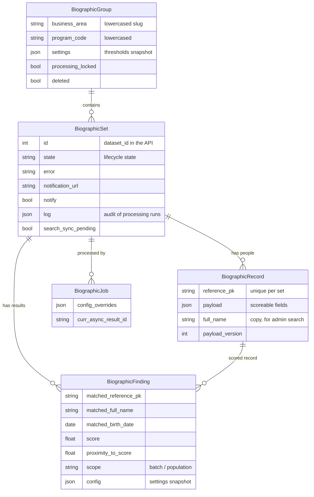

# Data Model

Five models in the `biographic` app hold the lifecycle and the results. Elasticsearch holds a searchable copy of the people, never the decisions.

## BiographicGroup

One business area and one program: the isolation unit. Created the first time a set is created for that pair, and maps one to one onto an Elasticsearch index.

- `settings` — the program's thresholds, snapshotted from the [Constance defaults](../admin/settings.md) at creation and editable in the admin.
- `processing_locked` — set while a run is in progress for the program.
- `deleted` — a deleted program refuses new sets with 409.

## BiographicSet

One submitted batch of people. Holds the [lifecycle state](lifecycle.md), the last `error`, the optional `notification_url`/`notify`, and an append-only `log` with one entry per run: timestamp, final state, config, records indexed, findings created, records whose hits were capped by `max_hits`, the outcome of every notification, and the traceback on failure.

`search_sync_pending` is set by approve, reject and cancel-from-failed in the same transaction as the state change, and cleared once Elasticsearch carries the matching status.

## BiographicRecord

One person. `reference_pk` is the client's identifier (a Country Workspace individual id); re-uploading it in the same set replaces the record. `payload` holds the scoreable fields exactly as sent:

| Field | Notes |
|-------|-------|
| `given_name`, `family_name`, `full_name`, `middle_name` | Text. `full_name` is what is matched when either given or family name is missing. |
| `birth_date` | ISO 8601 date. |
| `phone_no`, `phone_no_alternative` | Exact match. |
| `sex`, `relationship` | Exact match. |

The list lives in one place, `schemas.PAYLOAD_FIELDS`; the API serializer, the Elasticsearch mapping and the query are all checked against it.

## BiographicFinding

One scored pair, seen from one side: a record of the set and the person it matched.

- `matched_reference_pk` is a string, not a foreign key: a population match belongs to another set, possibly migrated from HOPE.
- `scope` is `batch` when the match is in the same set, `population` when it is in an approved set.
- `proximity_to_score` is `score` minus the threshold in force for that run.
- `config` is the settings snapshot used for the run.

If one person appears in two approved sets (two documents with the same `reference_pk`), only the best-scoring hit is kept per matched person and scope.

## BiographicJob

A [django-celery-boost](https://pypi.org/project/django-celery-boost/) job record per run, created by `process`. It carries the client's per-run `config_overrides`, the Celery task id, progress, and the cancellation flag the admin sets.

## Elasticsearch documents

Each record becomes one document in the program's index, with id `{dataset_id}:{reference_pk}`:

| Field | Value |
|-------|-------|
| payload fields | as above |
| `reference_pk`, `dataset_id` | identify the person and their set |
| `business_area`, `program_code` | the program |
| `status` | `pending` while the set is in flight, `approved` once approved, `rejected` once rejected or canceled |

Only `pending` documents of the set being processed and `approved` documents are ever searched. `dataset_id = 0` is reserved for documents migrated from HOPE.
