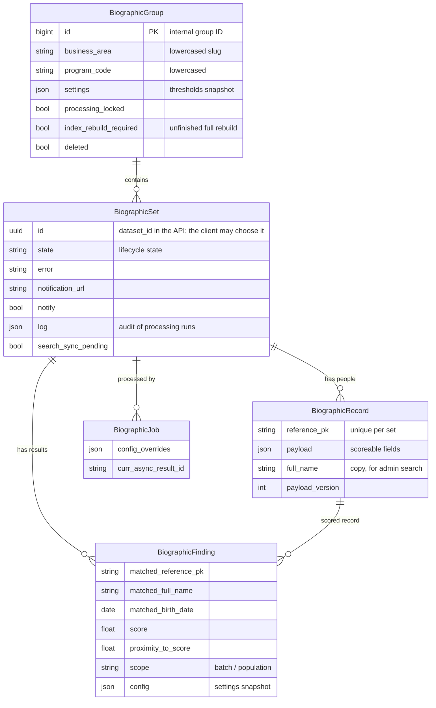

# Data Model

Five models in the `biographic` app hold the lifecycle and the results. Postgres owns the decisions; Elasticsearch holds a searchable copy of the people and their status.

## BiographicGroup

One business area and one program: the isolation unit. Created the first time a set is created for that pair; only one non-deleted group can exist per pair. Each group has its own Elasticsearch index, named `{ELASTICSEARCH_PREFIX}biographic_{group_id}` using its internal database PK. API clients continue to identify the program by business area and program code.

| Field | Meaning |
|-------|---------|
| `settings` | The program's thresholds, snapshotted from the [Constance defaults](../admin/settings.md) at creation. Editable in the admin for active groups; read-only after soft deletion. |
| `processing_locked` | Serializes processing and rebuilds. Taken before queueing and released by task cleanup; a killed worker may leave it set. |
| `index_rebuild_required` | Records an unfinished full rebuild. Set before index work and cleared only after restoration, refresh and status reconciliation finish. While set, processing, search and single-set rebuild jobs refuse to use the index. |
| `deleted` | Hides the group's sets from the API and prevents new processing or rebuilds for the group. |

Releasing the processing lock does not clear the recovery flag. See [Incomplete rebuilds](../admin/operations.md#incomplete-rebuilds) and [Recovering a stuck set](../admin/operations.md#recovering-a-stuck-set). The recovery flag records a rebuild attempt; it does not detect arbitrary missing documents.

[Deleting a program](../integration/workflow.md#deleting-a-program) keeps its database records and index. Creating a set for the same pair registers a new group with default settings and a separate index name. Its index is created when needed, and its population starts empty.

## BiographicSet

One submitted batch of people. Holds the [lifecycle state](lifecycle.md), the last `error`, the optional `notification_url`/`notify`, and an append-only `log` with one entry per run: timestamp, final state, config, records indexed, findings created, records whose hits were capped by `max_hits`, the outcome of every notification, and the traceback on failure.

`search_sync_pending` is set by approve, reject and cancel-from-failed in the same transaction as the state change, and cleared after successful status synchronization with Elasticsearch. It tracks this set's decision; full-index recovery is recorded separately on the group. See [Decisions that have not reached Elasticsearch](../admin/operations.md#decisions-that-have-not-reached-elasticsearch).

## BiographicRecord

One person. `reference_pk` is the client's identifier (a Country Workspace individual id); re-uploading it in the same set replaces the record. `payload` holds the scoreable fields exactly as sent:

| Field | Notes |
|-------|-------|
| `given_name`, `family_name`, `full_name`, `middle_name` | Text. `full_name` is required, and is what is matched when either given or family name is missing. |
| `birth_date` | ISO 8601 date. |
| `phone_no`, `phone_no_alternative` | Exact match. |
| `sex`, `relationship` | Exact match. |

The list lives in one place, `schemas.PAYLOAD_FIELDS`; the API serializer, the Elasticsearch mapping and the query are all checked against it.

## BiographicFinding

One scored pair, seen from one side: a record of the set and the person it matched.

- `matched_reference_pk` is a string, not a foreign key: a population match belongs to another set, possibly migrated from HOPE.
- `scope` is `batch` when the match is in the same set, `population` when it is in an approved set.
- `proximity_to_score` is `score` minus the threshold in force for that run.
- `config` is the settings snapshot used for the run.

If one person appears in two approved sets (two documents with the same `reference_pk`), only the best-scoring hit is kept per matched person and scope.

## BiographicJob

A [django-celery-boost](https://pypi.org/project/django-celery-boost/) job record per run, created by `process`. It carries the client's per-run `config_overrides`, the Celery task id, progress, and the cancellation flag the admin sets.

## Elasticsearch documents

Each record becomes one document in the program's index, with id `{dataset_id}:{reference_pk}`:

| Field | Value |
|-------|-------|
| payload fields | as above |
| `reference_pk`, `dataset_id` | identify the person and their set |
| `business_area`, `program_code` | the program |
| `status` | `pending` while the set is in flight, `approved` once approved, `rejected` once rejected or canceled |

Only `pending` documents of the set being processed and `approved` documents are ever searched. `dataset_id = 0` is reserved for documents migrated from HOPE.
