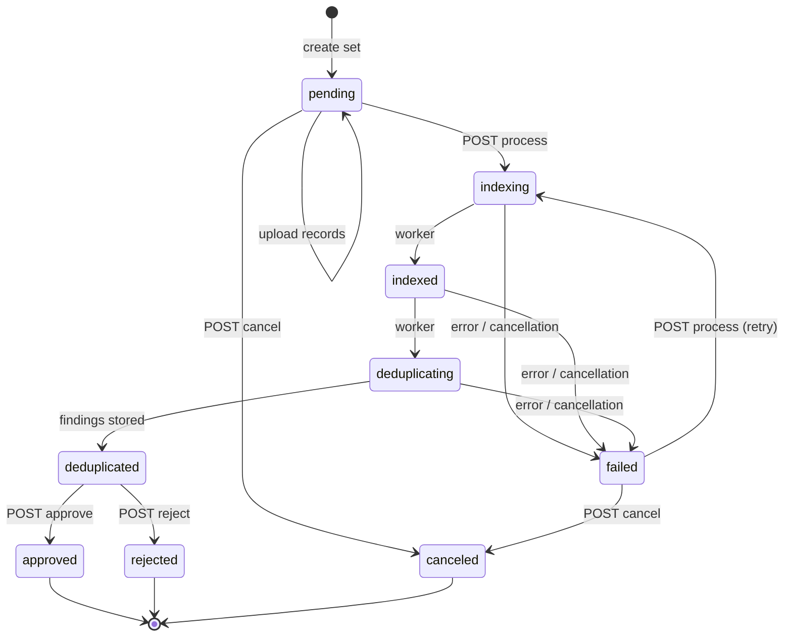

# Set Lifecycle

Every biographic set moves through a state machine kept in Postgres. The API returns the state as `status` (e.g. `"pending"`, `"deduplicated"`), and it decides which operations are allowed. An operation not allowed in the current state is rejected with **HTTP 409 Conflict** and a message naming the state.

## State diagram

!!! info "About the transitions"
    - `indexing → indexed → deduplicating → deduplicated` happen inside one worker run, with a notification at each step.
    - A run never aborts because a set has *many* duplicates: HOPE's "too many duplicates" abort rules are deliberately not implemented. The run always ends `deduplicated`, and the client decides what the counts mean.
    - `failed` covers unexpected errors and a graceful cancellation requested by an administrator. The reason is in the set's `error`.

## States

| State | Meaning | What the client can do |
|-------|---------|------------------------|
| `pending` | Created, accepting records. | Upload batches; `process`; `cancel`. |
| `indexing` | The worker is writing the set's people into Elasticsearch. | Wait (poll or receive notifications). |
| `indexed` | Indexed and searchable; scoring is about to start. | Wait. |
| `deduplicating` | The worker is scoring every person. | Wait. |
| `deduplicated` | Findings stored. | Read `pairs`; then `approve` or `reject`. |
| `failed` | The run stopped; reason in `error`. Partial findings are discarded by the next run. | `process` again, or `cancel`. |
| `approved` | **Final.** The set's people join the program's population; every later set is checked against them. | Pairs stay readable. |
| `rejected` | **Final.** The set is discarded; its documents are deleted from Elasticsearch by the daily cleanup. | — |
| `canceled` | **Final.** Abandoned before a decision. Its documents, if any were indexed, are treated like a rejected set's. | — |

## Programs: one active set at a time

A set belongs to a **program**: a business area slug plus a program code, both taken from the URL and lowercased (`AFG` and `afg` are the same program). Programs enforce two rules:

1. **Single active set.** Only one set per program can be in `indexing`, `indexed`, `deduplicating` or `deduplicated`. `process` on a second set returns 409 until the first is approved or rejected. Creating sets and uploading records is always allowed, so a client can prepare the next batch while one is in flight. A database constraint backs this rule, so two concurrent `process` calls cannot both win.
2. **Processing lock.** Only one run per program at a time. The view takes the lock before queueing; the worker releases it when the run ends, whatever the outcome. Approve, reject and cancel never touch it.

**Approved sets are cumulative.** Each run scores its people against the rest of the set *and* every approved set in the program. That is how a new intake batch is checked against people already accepted.

## Changing settings

A program's thresholds can be changed by an administrator at any time, and a client can override them for a single run. A run reads its settings once when it starts and stores a snapshot on every finding, so a change affects only the next run, and nothing is cleared or refused. See [Configuration](../integration/configuration.md).
