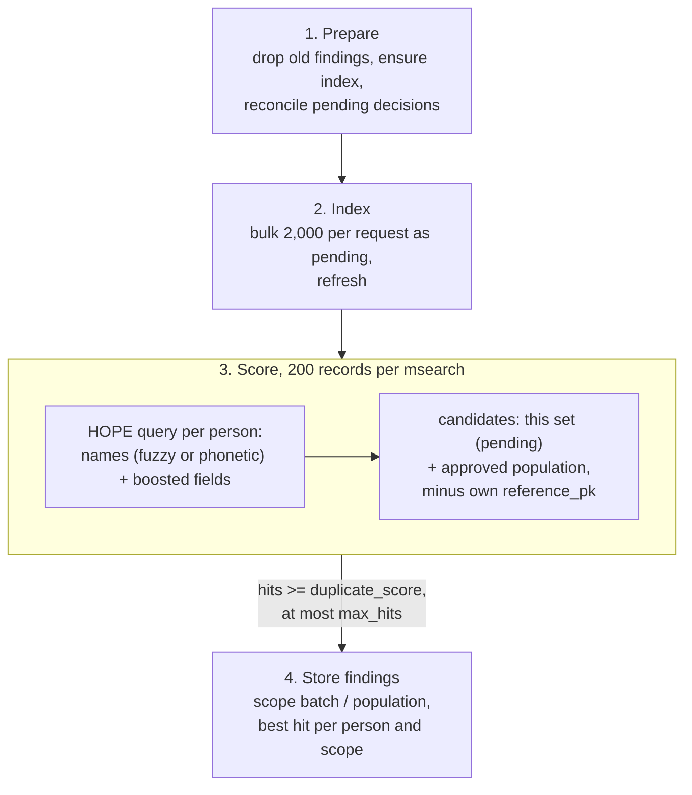

# Scoring Pipeline

When a set is processed, the worker indexes its people into the program's Elasticsearch index, searches for each of them, and stores every hit above the threshold as a finding. The scoring is HOPE's: the duplicate threshold is calibrated against these exact settings, so a change to any of them silently changes what a score means.

## Stage 1 — Prepare

- Delete any findings left in Postgres by a previous, failed run of the same set.
- Create the program's index if it does not exist, after checking that the cluster has the `analysis-phonetic` plugin (without it, the run fails with an error saying so).
- **Reconcile**: push every decision in the program that has not reached Elasticsearch yet (`search_sync_pending`). Only then is anything searched, so the population is exactly what Postgres says it is.

## Stage 2 — Index

The set's records are written in bulk, 2,000 per request, as `pending` documents with id `{dataset_id}:{reference_pk}`. A retry overwrites the same documents rather than duplicating them. The index is refreshed so that the documents are searchable.

## Stage 3 — Score

Records are searched 200 at a time in one `msearch` request each. Every search is the HOPE query for one person:

**Candidates** (a filter, does not score): documents of this set that are still `pending`, plus every `approved` document in the program. Rejected documents, and other sets still in flight, are never candidates. The person's own `reference_pk` is excluded.

**Names** — the bulk of the score:

| Payload has | Clause | Approximate contribution |
|-------------|--------|--------------------------|
| given **and** family name | best of "either name matches" and "both names match" (×4) | both match: about 8; one matches: about 1 |
| only one of them | `full_name` match, all words required, boost 8 | up to 8 |
| no name | none | 0 |

Each name is matched by spelling (fuzzy, `AUTO:3,6`: no typo allowed up to 2 letters, one up to 5, two beyond) or by sound (Double Metaphone), whichever scores better. `given_name` also expands nicknames from the synonyms file (Bill / William).

**Other fields**, each added when present in the payload:

| Field | Boost |
|-------|-------|
| `birth_date` | 2 |
| `phone_no` | 2 |
| `phone_no_alternative` | 2 |
| `sex` | 1 |
| `relationship` | 1 |
| `middle_name` | 1 |

**Similarity.** HOPE replaces Elasticsearch's relevance scoring with `boost / number_of_tokens`, so a matching field scores its boost, and a common name is worth as much as a rare one. Phone numbers and the business area are exact-match fields.

Elasticsearch drops everything below `duplicate_score` (default **6.0**) and returns at most `max_hits` (default 100) per person, best first. With the defaults, matching given and family names is on its own a duplicate; one name plus birth date and phone is not (about 5).

!!! warning "Synonym inflation"
    A given name spelled *outside* a synonym group, but close to several spellings in it, can score far above the usual maximum: "Muhammad Ali" against a stored "Mohammed Ali" scores **35.14**, where an exact match scores 8. "Muhammad Khan" against "Mohammed Ali" scores 7.79, a duplicate on the first name alone. HOPE has the same behaviour and its threshold is calibrated against it, so it is kept. See [the 35.14 case](#synonym-inflation-the-3514-case) for the full breakdown.

### Synonym inflation: the 35.14 case

All numbers below were measured on Elasticsearch with the engine's own index settings and query, using `explain`.

**1. The stored name becomes 15 words in the same place.** `given_name` is analysed with the synonyms file at index time. "Mohammed" is in this group of the bundled file:

```
mohamed, mohammed, mohammad, muhammed, mohamad, muhamad, muhamed, mohamud,
mohummad, mohummed, mouhamed, mohammod, mouhamad, muhammet, muxamed
```

So a stored "Mohammed" is indexed as all 15 spellings, all at position 0. Overlapping words do not count towards the field's length, so the field still has length 1, and the similarity (`boost / number_of_tokens`) divides by 1.

**2. The searched name is not in the group, so it is matched by spelling.** "Muhammad" (with an *a* before the final *d*) is not in the group. The query analyser leaves it as one word, `muhammad`, and the fuzzy query looks for every indexed word within two typos (`AUTO:3,6` allows two for words longer than 5 letters).

**3. Every close spelling counts, and the scores add up.** A fuzzy query is rewritten into one clause per matching indexed word, and the clauses are summed. Each clause is weighted by how close the word is: 1 − typos ÷ length of the shorter word. Normally a document holds only one spelling, so only one clause matches and the name is worth at most 1. Here the document holds 15 spellings, and 10 of them are within two typos:

| Stored spelling | Typos from `muhammad` | Weight |
|-----------------|-----------------------|--------|
| mohammad | 1 | 0.875 |
| muhammed | 1 | 0.875 |
| muhamad | 1 | 0.857 |
| mohammed | 2 | 0.750 |
| mohummad | 2 | 0.750 |
| mohammod | 2 | 0.750 |
| mouhamad | 2 | 0.750 |
| muhammet | 2 | 0.750 |
| mohamad | 2 | 0.714 |
| muhamed | 2 | 0.714 |
| mohamed, mohamud, mohummed, mouhamed, muxamed | 3 | not matched |
| **Given name total** | | **7.786** |

The sound match on the same name (Double Metaphone) scores 1. The given-name clause takes the better of spelling and sound, so it is worth **7.786** instead of at most 1.

**4. The name clause multiplies it.** With given and family names both present, the query takes the better of two branches:

| Branch | "Muhammad Ali" vs "Mohammed Ali" | "Muhammad Khan" vs "Mohammed Ali" |
|--------|----------------------------------|-----------------------------------|
| either name matches: given + family | 7.786 + 1 = 8.786 | 7.786 + 0 = 7.786 |
| both names match, × 4 | 4 × (7.786 + 1) = **35.14** | family does not match: no score |
| **Score** | **35.14** | **7.79** — above the 6.0 default, so a duplicate |

**5. It only happens in one direction.** The inflation needs the *stored* name to be in the group and the *searched* name to be outside it. Searching a listed spelling expands the query to the same group, which is then scored as one word:

| Searched | Stored "Mohammed Ali" | Stored "Mohamed Ali" | Stored "Muhammad Ali" |
|----------|-----------------------|----------------------|-----------------------|
| Mohammed Ali | 8 | 8 | 8 |
| Mohamed Ali | 8 | 8 | 8 |
| Muhammad Ali | 35.14 | 35.14 | 8 |

So when two such people are in the same set, the two batch findings between them have different scores: Muhammad → Mohammed is 35.14, Mohammed → Muhammad is 8.

**Consequences.** A misspelling outscores an exact match, a shared first name can be a duplicate without any other field, and `proximity_to_score` for these findings is not comparable with ordinary ones. Any synonym group with many close spellings behaves this way; Mohammed is the largest in the bundled file. HOPE uses the same analyser, synonyms file and query, so it scores these cases the same way. Changing it would break that parity.

## Stage 4 — Store findings

Each hit becomes a finding with `scope = batch` if it belongs to the same set, `population` if it belongs to an approved set. Only the best hit per matched person and scope is kept. Findings are written per chunk, and the job's progress is updated after each chunk; the cancellation flag is checked before each chunk too.

A record whose hit count reaches `max_hits` is counted as *truncated* in the run log: it may have more matches than were stored.

## Overview diagram


