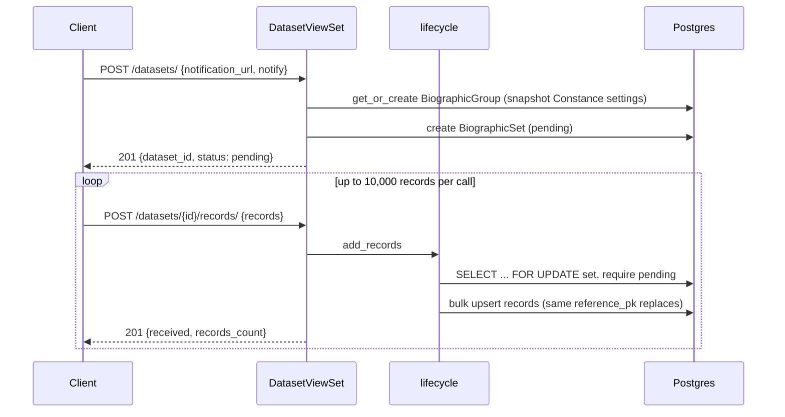
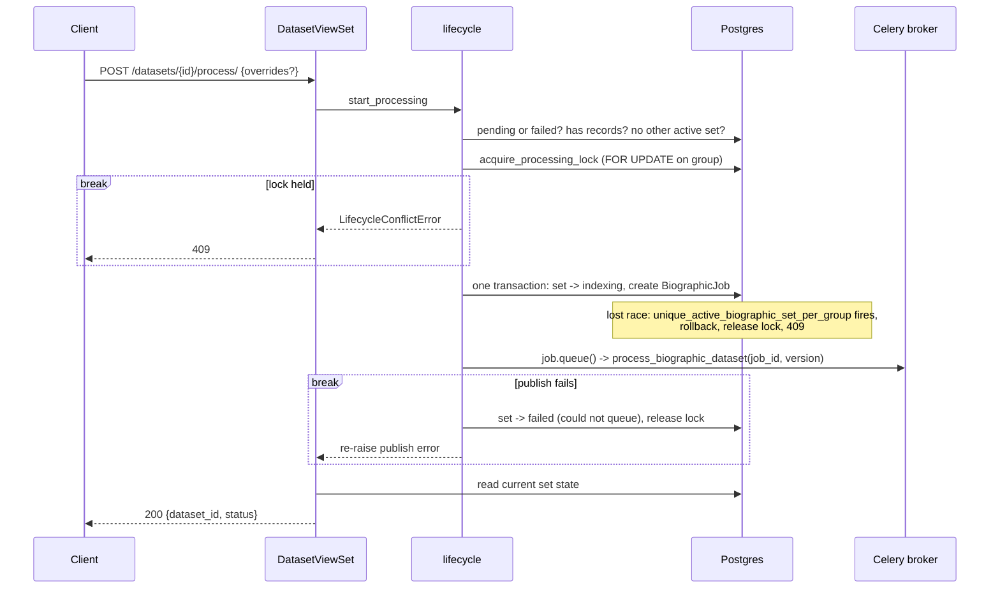
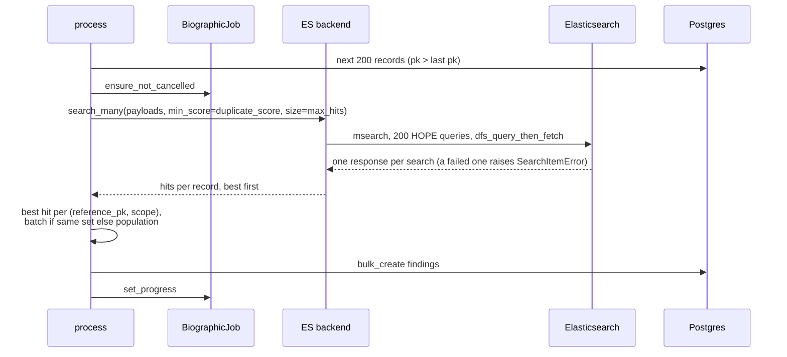
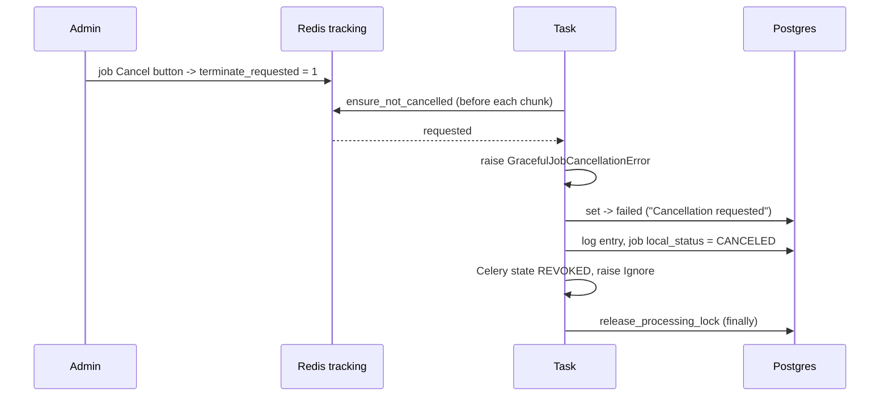
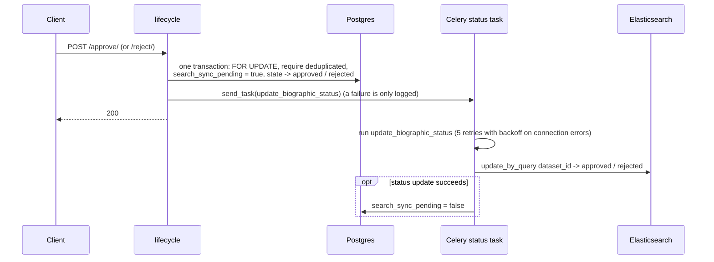
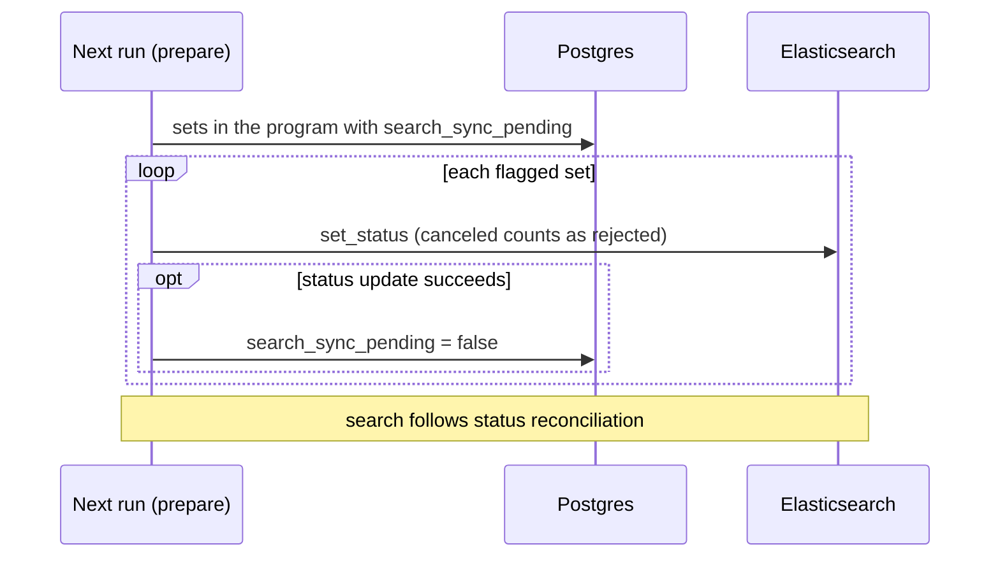
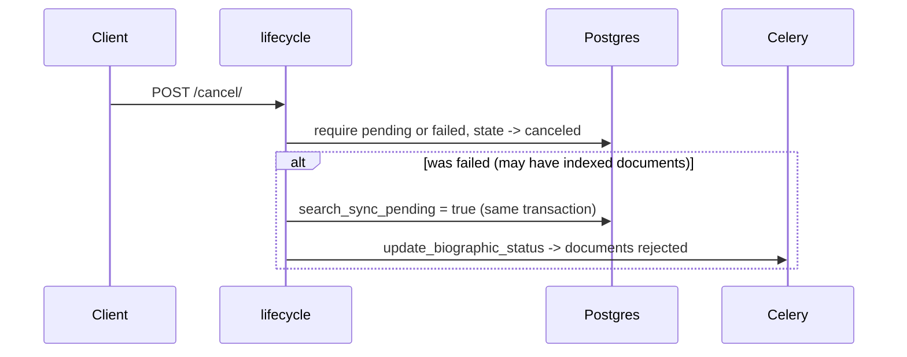
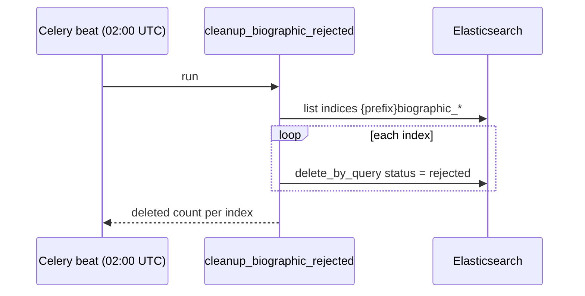
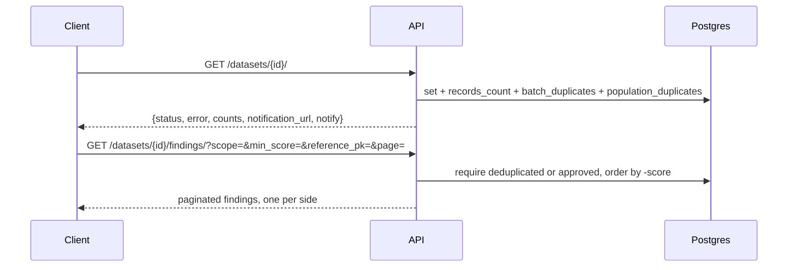
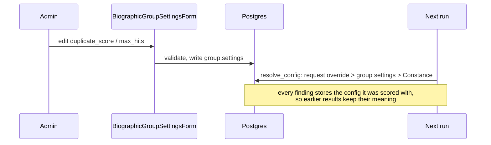

# Sequence Diagrams

One small diagram per flow. Participants are named after the code: `lifecycle` is `services/lifecycle.py`, `process` is `services/process.py`, the task is `process_biographic_dataset` in `celery_tasks.py`.

## Create a set and upload people



## Start processing

The API queues the run; index readiness is checked later by the worker. See [Start processing](../integration/workflow.md#3-start-processing) for the request and response contract.



## Worker run, happy path

The full run follows [Prepare](pipeline.md#stage-1-prepare). For index-only and search-only runs, see [admin indexing and searching](../admin/operations.md#indexing-and-searching-from-the-admin).

```mermaid
sequenceDiagram
    participant W as process_biographic_dataset
    participant P as process
    participant ES as Elasticsearch
    participant DB as Postgres
    participant H as notification_url

    W->>DB: load job, set, group
    W->>H: GET (indexing)
    W->>P: prepare
    P->>DB: require index_rebuild_required = false
    P->>ES: index_exists; check existing dataset_id and status mappings
    opt index is missing
        P->>DB: require no approved sets
    end
    P->>DB: delete this set's findings
    P->>ES: ensure_index
    P->>ES: reconcile pending decisions
    W->>P: index
    loop 2,000 records per bulk request
        P->>ES: index as pending
    end
    P->>ES: refresh
    W->>DB: set -> indexed
    W->>H: GET (indexed)
    W->>DB: set -> deduplicating
    W->>H: GET (deduplicating)
    W->>P: deduplicate
    W->>DB: set -> deduplicated
    W->>H: GET (deduplicated)
    W->>DB: append log entry
    W->>DB: release_processing_lock (finally)
```

## Scoring one chunk



## Failure and retry

Readiness failures leave previous findings stored. For a missing population index or an unfinished full rebuild, [rebuild the group](../admin/operations.md#incomplete-rebuilds) before retrying the failed set.

```mermaid
sequenceDiagram
    participant W as Task
    participant DB as Postgres
    participant H as notification_url
    participant C as Client
    participant API as DatasetViewSet

    W->>W: exception during preparation, indexing or scoring
    W->>DB: re-read set; if still running -> failed (error)
    W->>H: GET (failed)
    W->>DB: log entry with traceback
    W->>W: report to Sentry, re-raise (Celery FAILURE)
    W->>DB: release_processing_lock (finally)

    C->>API: POST /process/ again (set is failed)
    Note over C,API: new job; clear findings only after readiness checks pass
    Note over C,API: indexing overwrites the same document IDs
```

## Graceful cancellation from the admin



## Approve or reject, then mirror into Elasticsearch



## Reconcile at the start of the next run

During processing, reconciliation follows the readiness checks. It synchronizes [pending decisions](../admin/operations.md#decisions-that-have-not-reached-elasticsearch); it does not restore missing documents or clear the group's recovery flag.



## Cancel a pending or failed set



## Daily cleanup



## Reading results



## Changing a program's thresholds


