# Sequence Diagrams

One small diagram per flow. Participants are named after the code: `lifecycle` is `services/lifecycle.py`, `process` is `services/process.py`, the task is `process_biographic_dataset` in `celery_tasks.py`.

## Create a set and upload people

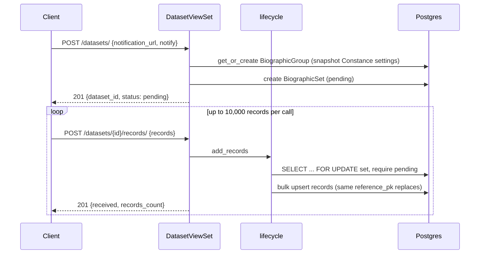

## Start processing

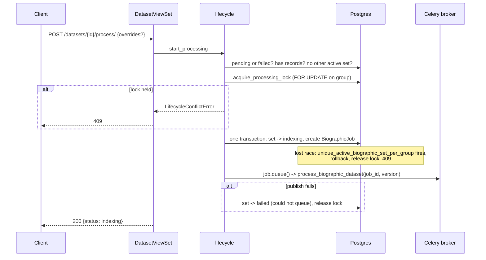

## Worker run, happy path

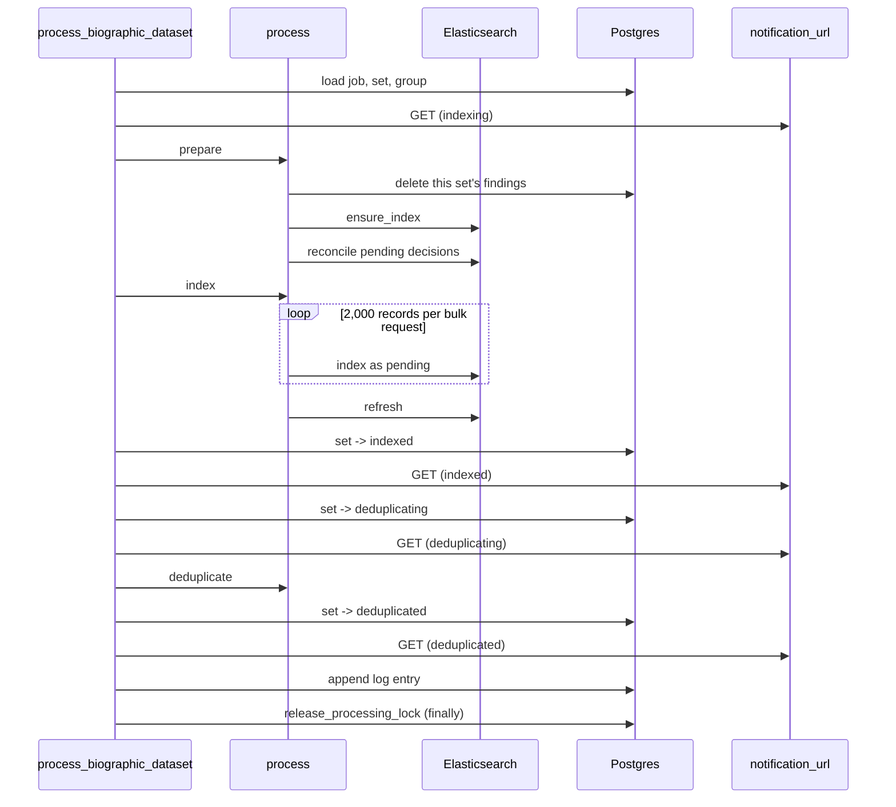

## Scoring one chunk

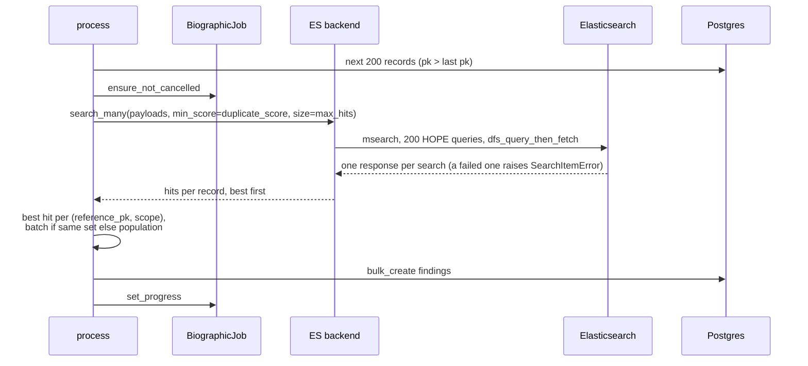

## Failure and retry

```mermaid
sequenceDiagram
    participant W as Task
    participant DB as Postgres
    participant H as notification_url
    participant C as Client

    W->>W: exception while indexing or scoring
    W->>DB: re-read set; if still running -> failed (error)
    W->>H: GET (failed)
    W->>DB: log entry with traceback
    W->>W: report to Sentry, re-raise (Celery FAILURE)
    W->>DB: release_processing_lock (finally)

    C->>DB: POST /process/ again (set is failed)
    Note over C,DB: new job; prepare deletes partial findings;<br>same document ids overwrite the pending documents
```

## Graceful cancellation from the admin

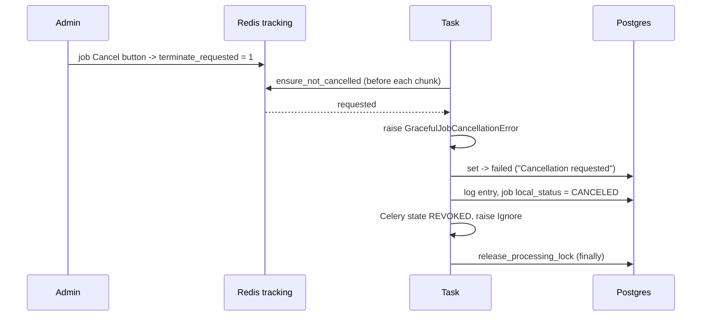

## Approve or reject, then mirror into Elasticsearch

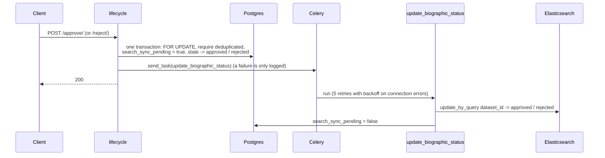

## Reconcile at the start of the next run

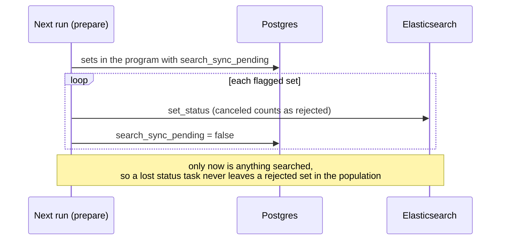

## Cancel a pending or failed set

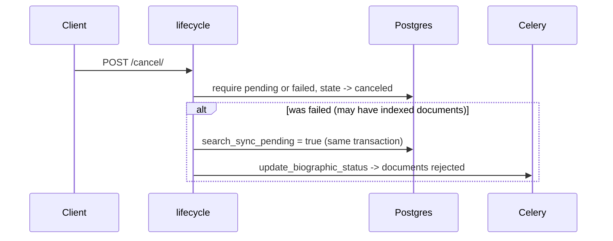

## Daily cleanup

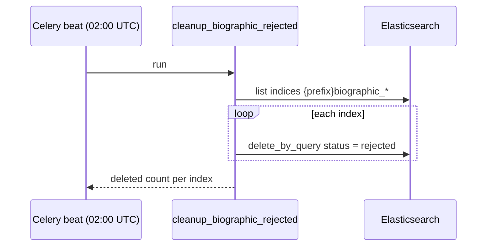

## Reading results

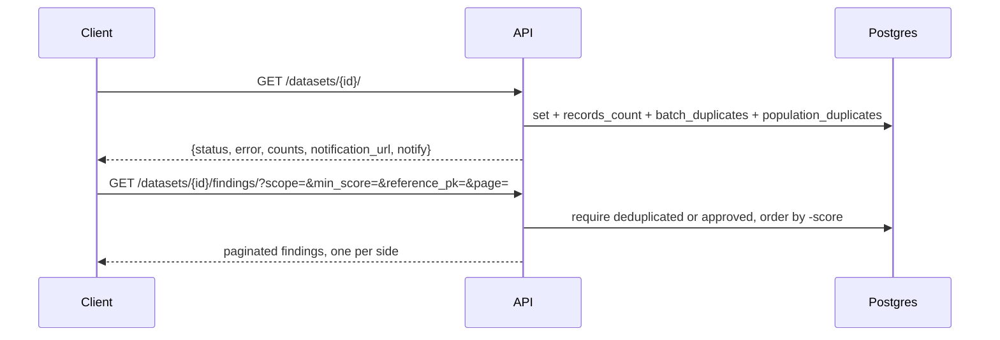

## Changing a program's thresholds

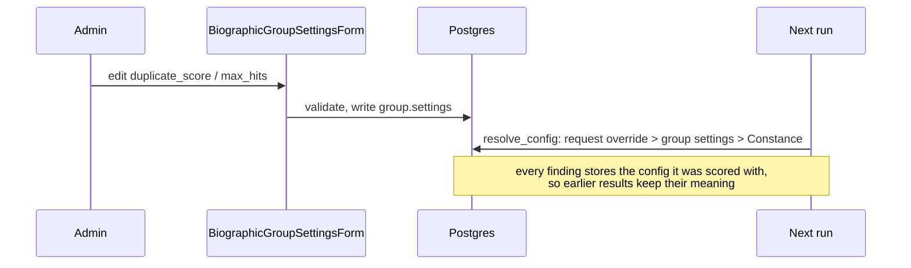
