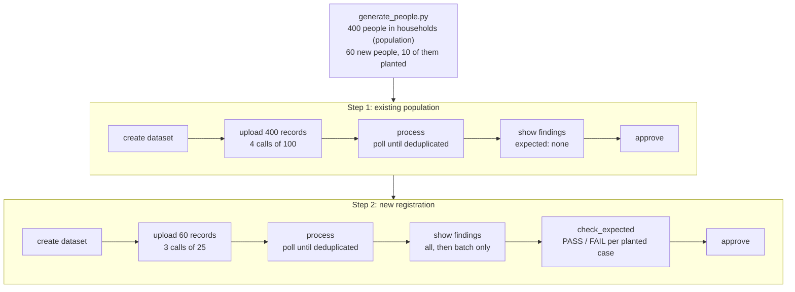
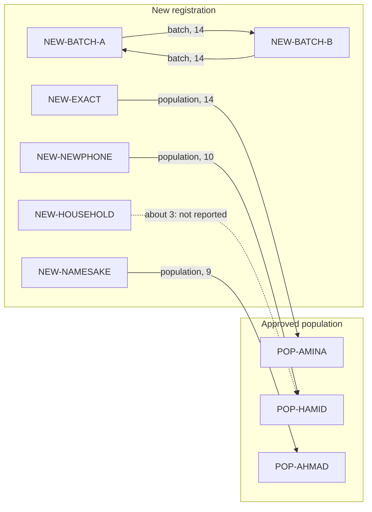
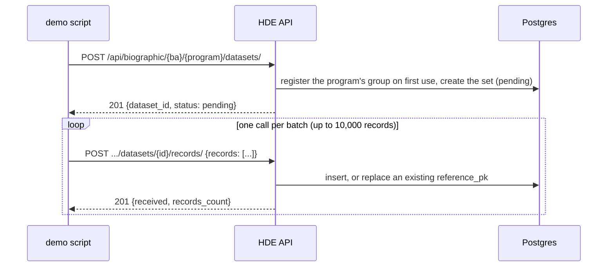
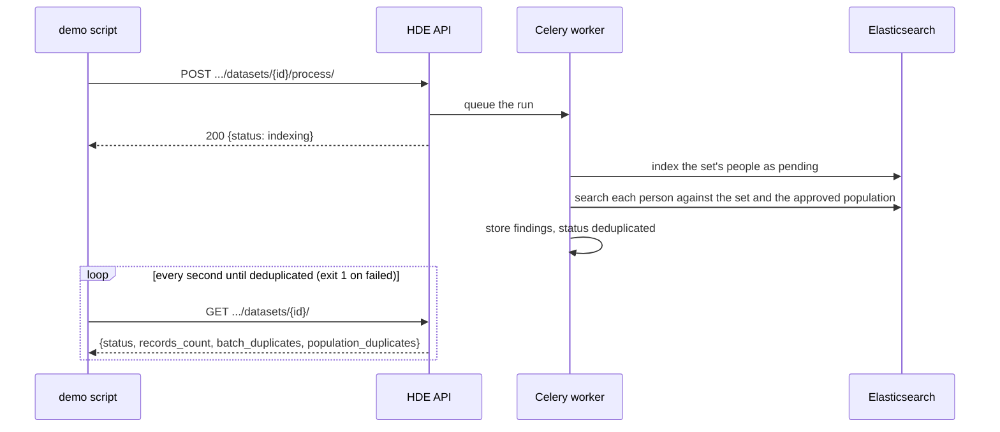
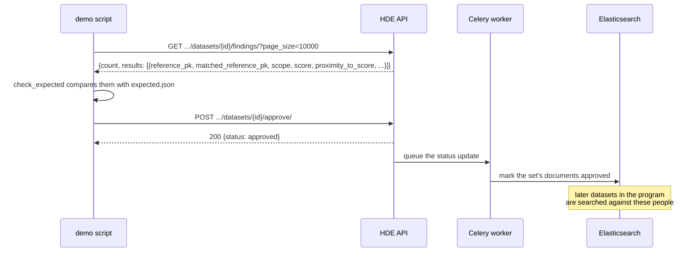
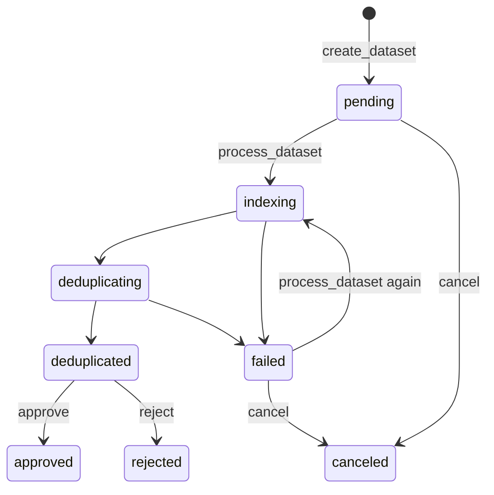

# Demo Scripts

Shell scripts in `tests/extras/demoapp/biographic/` drive the biographic API end to end, the way HOPE would. They need [httpie](https://httpie.io/), [jq](https://jqlang.github.io/jq/) and `python3` (standard library only, for the fake data).

`full_flow` runs the whole scenario on a fresh program. A program's existing population is processed and approved first, then a new registration is deduplicated against it. The new registration contains planted cases, each a known variation of an existing person, and the script checks that every one of them comes out as expected.

## Running it

Start the stack as described in the [biometric demo](../../development/demo.md#running-the-demo-server) (`docker compose up --build`). Then create an API token under `Home › Api › Tokens` with the `API_BIOGRAPHIC` grant, or use a superuser's token.

```console
$ cd tests/extras/demoapp/biographic
$ ./use_base_url http://localhost:8000
$ ./use_auth_token <token>
$ ./full_flow                      # business area "afghanistan", a new program demo-<timestamp>
$ ./full_flow afghanistan my-demo  # or choose both
```

Each run uses a new program by default: a reused program already holds the people of earlier runs, and they would match the new ones.

## The scenario



### The fake people

The population is made of households: a head, often a spouse, and up to three children, sharing a family name and the head's phone number. Every given and family name pair is unique, and no two names in the lists can be confused by spelling or sound, so the filler people never match each other. Every finding the API reports is therefore a planted one.

The new registration adds 50 unrelated people and these planted cases:

| New record | Population person | Variation | Expected | Score |
|------------|-------------------|-----------|----------|-------|
| `NEW-EXACT` | `POP-AMINA` | identical | duplicate | 14 |
| `NEW-SOUNDALIKE` | `POP-MARIAM` | Maryam / Mariam, same sound | duplicate | 14 |
| `NEW-TYPO` | `POP-RAHIM` | Rhaim / Rahim, a typo | duplicate | 13.2 |
| `NEW-NICKNAME` | `POP-JOHN` | Johnny / John, from the synonyms file | duplicate | 14 |
| `NEW-NOGIVEN` | `POP-NADIA` | given name missing, full name sent | duplicate | 14 |
| `NEW-NEWPHONE` | `POP-HAMID` | new phone, corrected birth date | duplicate | 10 |
| `NEW-NAMESAKE` | `POP-AHMAD` | same names, different birth date and phone | duplicate | 9 |
| `NEW-HOUSEHOLD` | `POP-HAMID` | his wife: same family name and phone | not a duplicate | about 3, below 6 |
| `NEW-BATCH-A` / `NEW-BATCH-B` | each other | the same person twice in the new registration | duplicate (`batch`) | 14 |

The namesake shows a property of the scoring rather than a bug: matching given and family names (8 points) clear the default threshold of 6 on their own, so namesakes need a human decision. See [Scoring Pipeline](../concepts/pipeline.md).



## What happens on each call

### Creating a dataset and uploading people



There is no endpoint for creating a group: the first dataset created for a business area and program registers it, with the default settings. Its thresholds can then be changed in the admin.

### Processing



### Reading the findings and approving



If the status update fails, the next run of the program applies it before searching, so the population is always complete.

### Dataset states seen by the scripts



While a dataset is being processed or waits in `deduplicated`, the program's other datasets cannot be processed (409). This is why `full_flow` approves the population before processing the new registration.

## Scripts

State (base URL, token, program, current dataset) is kept in `.vars`, created on first use and ignored by git. Generated data goes to `data/`, also ignored.

| Script | Arguments | Description |
|--------|-----------|-------------|
| `use_base_url` | base url | Sets the API base URL |
| `use_auth_token` | token | Sets the API token |
| `use_program` | business area, program code | Selects the program for the following commands |
| `create_dataset` | `[notification_url]` | Creates a dataset and selects it |
| `upload_records` | file, `[batch_size]` (default 100) | Uploads a JSON list of `{reference_pk, payload}` in batches |
| `process_dataset` | `[overrides]`, e.g. `duplicate_score:=8` | Starts processing and polls until `deduplicated`; exits 1 on `failed` |
| `show_dataset` | – | Shows the dataset, with its state and duplicate counts |
| `show_findings` | `[--json] [filters]`, e.g. `scope==batch min_score==10 reference_pk==NEW-EXACT` | Lists the findings as a table, best first |
| `approve` / `reject` / `cancel` | – | Decides or abandons the dataset |
| `generate_people.py` | output dir, `[--population N] [--new N] [--seed N]` | Writes `population.json`, `new_registration.json` and `expected.json` |
| `check_expected` | `[expected.json]` | Compares the findings with the planted cases; exits 1 on any mismatch |
| `full_flow` | `[business_area] [program_code]` | Runs the whole scenario above |

Failed calls print the API's error and stop the script, for example `{"detail": "Cannot process set in 'Canceled' state."}`.
