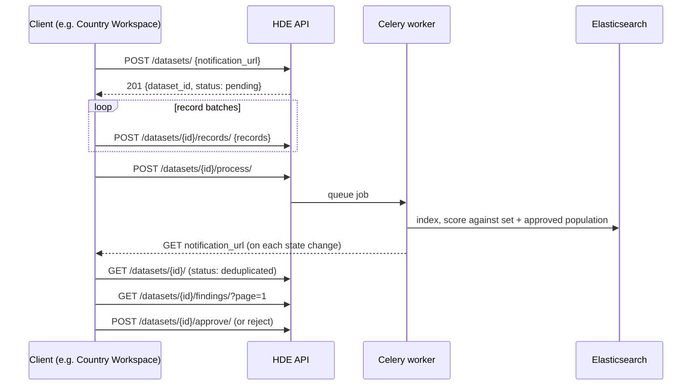

# End-to-End Workflow

A complete run, from creating the set to approving it. Examples use [httpie](https://httpie.io/); `$P` is `https://<server>/api/biographic/afg/prog-2026`, and the `Authorization` header is omitted for brevity.



Each step is drawn in more detail on the [sequence diagrams](../concepts/sequence-diagrams.md) page.

## 1. Create a set

```console
$ http POST $P/datasets/ \
    notification_url="https://cw.example.org/hde-callback?batch=42" \
    notify:=true
```

```json
{
    "dataset_id": 17,
    "status": "pending",
    "error": null,
    "records_count": 0,
    "batch_duplicates": 0,
    "population_duplicates": 0,
    "notification_url": "https://cw.example.org/hde-callback?batch=42",
    "notify": true,
    "created_at": "2026-10-13T10:00:00Z",
    "updated_at": "2026-10-13T10:00:00Z"
}
```

- The body is optional; see [Notifications](notifications.md) for both fields.
- Creating a set is **always allowed**, even while another set in the program is being processed or awaiting a decision.
- Returns **409** if biographic deduplication was deleted for this program.

## 2. Upload records

```console
$ http POST $P/datasets/17/records/ <<< '{
    "records": [
        {"reference_pk": "IND-0001", "payload": {
            "given_name": "Amina", "family_name": "Yusuf", "full_name": "Amina Yusuf",
            "birth_date": "1990-04-12", "phone_no": "+93700111222", "sex": "FEMALE"}},
        {"reference_pk": "IND-0002", "payload": {
            "given_name": "Omar", "family_name": "Yusuf", "full_name": "Omar Yusuf",
            "birth_date": "1987-01-03", "sex": "MALE", "relationship": "HEAD"}}
    ]
}'
```

```json
{"received": 2, "records_count": 2}
```

- Up to **10,000** records per call; send as many calls as needed.
- Re-sending a `reference_pk` already in the set **replaces** that record, so a batch can be safely retried after a timeout. The same `reference_pk` twice in one batch is a 400.
- Payload fields: `given_name`, `family_name`, `full_name`, `middle_name`, `birth_date` (ISO date), `phone_no`, `phone_no_alternative`, `sex`, `relationship`. Only `full_name` is required and it cannot be null or empty; the others are optional and nullable. Unknown keys are dropped; values are stored as sent, without trimming.
- `full_name` is what is matched when either given or family name is missing, so a batch with a record that lacks it is rejected.
- Returns **409** once the set has left `pending`.

## 3. Start processing

```console
$ http POST $P/datasets/17/process/
```

The response is the set, now `indexing`. The body may override the program's settings for this run only:

```console
$ http POST $P/datasets/17/process/ duplicate_score:=8.0 max_hits:=50
```

An unknown key is a **400**, so a misspelt threshold cannot silently run with the default. See [Configuration](configuration.md).

Returns **409** when:

- the set is not `pending` or `failed`,
- the set has no records,
- another set in the program is being processed or awaiting approval, or
- a run is already in progress for the program.

`process` on a `failed` set is the **retry**: the new run discards the partial results of the failed one.

Processing is asynchronous. Track it by [polling or notifications](notifications.md):

```console
$ http GET $P/datasets/17/
{
    "dataset_id": 17,
    "status": "deduplicated",
    "error": null,
    "records_count": 4480,
    "batch_duplicates": 612,
    "population_duplicates": 0,
    ...
}
```

`batch_duplicates` and `population_duplicates` count **records** with at least one finding in that scope, as HOPE counts per individual.

## 4. Read the findings

```console
$ http GET "$P/datasets/17/findings/?page=1&page_size=1000"
```

Available in `deduplicated` and `approved`; **409** otherwise. See [Findings and statuses](findings-and-statuses.md).

## 5. Approve or reject

Both are final and only allowed in `deduplicated`:

```console
$ http POST $P/datasets/17/approve/
$ http POST $P/datasets/17/reject/
```

- **Approve** accepts the set. Its people join the program's population, and every later set in the program is scored against them.
- **Reject** discards the set. Its people are never matched against again.

Either one frees the program for the next set. The change reaches Elasticsearch asynchronously, and the next run makes sure it has before it searches.

!!! warning "Approval affects every future run"
    Approved people are permanent reference data for the program. Approve only after the duplicates have been resolved.

## Cancelling a set

```console
$ http POST $P/datasets/17/cancel/
```

Abandons a `pending` or `failed` set; it is final. A set that is processing or awaiting a decision cannot be cancelled: wait for it, then reject it.
